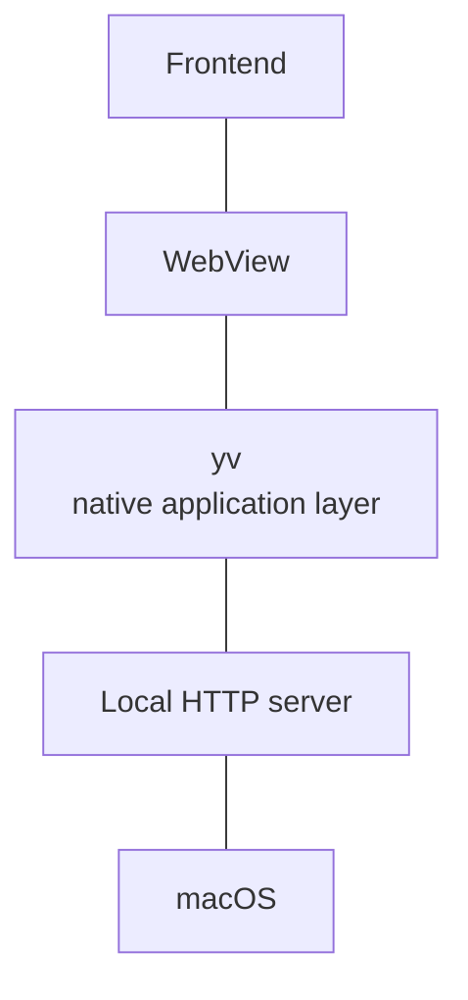

<p align="center">
  
</p>

<h1 align="center">yv</h1>

<p align="center">
  <strong>A lightweight C-based WebView runtime for macOS.</strong>
  <br>
  Build desktop applications with C, HTML, CSS, and JavaScript/TypeScript.
</p>

<br>

## 0. Quick Start

### Requirements
- Xcode Command Line Tools (macOS only)
- CMake, Ninja, C compiler with C17 support
- Node.js 22+

### Start
```bash
# Create Project
npm create yv@latest myapp
cd myapp

# Start the application in development mode
make

# Build the application for production
make build

# Launch the built application packaged file
open -n dist/myapp.app
```

<br>

## 1. What is this?
`yv` is a small desktop application runtime written in C.

The name comes from: `yume + view`.
<br>
`yume` comes from the author's name, and `view` refers to the WebView at the core of the runtime.

### How It Works
At a high level, `yv` combines a few small components:



`yv` does not implement the platform WebView itself.

Instead, it uses the existing [`webview/webview`](https://github.com/webview/webview) project as the WebView abstraction layer and [`CivetWeb`](https://github.com/civetweb/civetweb) for serving local application assets.

This keeps the runtime focused on the application layer rather than reimplementing platform-specific WebView functionality.

<br>

## 2. Features
- macOS Only
- WebView-based desktop applications
- Local static asset serving
- HTML / CSS / TypeScript / esbuild
- Basic macOS application menu
- Custom application icon

<br>

## 3. Roadmaps
- [x] TypeScript with esbuild
- [ ] Tailwind CSS
- [ ] HTMX
- [ ] LLM
  - [ ] Ollama (API)
  - [ ] llama.cpp (Built-in, for Local Model)
  - [ ] OpenAI, Anthropic, Google, xAI, ...
- [ ] Windows and Linux support
- [ ] Python
- [ ] WASM (To help with high-performance operations in the frontend)
- [ ] WebSocket for serving local application assets
